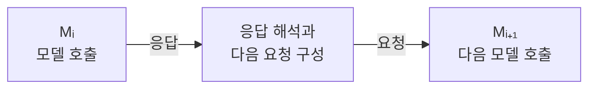
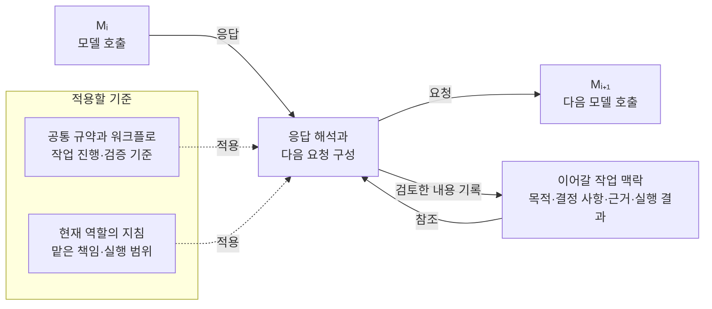

# AI-Native Engineering Framework

## 사람과 AI의 협업 방식을 설계한 이유

프로그래밍을 할 때, AI와 문제를 의논하고 실행 계획을 세운 뒤 실제 결과를 검증하는 과정까지 함께 수행할 수 있는 협업 방식을 만들고자 했습니다. 프로젝트가 달라져도 작업의 목적과 제약을 이해하고, 그 일에 필요한 워크플로를 구성해 실행할 수 있도록 하는 것이 목표였습니다.

AI와 작업하는 기본 흐름은 요청을 전달하고, 응답을 받은 뒤, 그 내용을 바탕으로 다음 요청을 구성하는 과정의 반복으로 볼 수 있습니다. 대화 화면에서 직접 요청하거나 API를 통해 전달하더라도, 이 관계는 아래처럼 단순하게 나타낼 수 있습니다.

여기서 Mᵢ와 Mᵢ₊₁은 이어지는 두 번의 모델 호출을 뜻하며, 서로 다른 모델이나 agent를 의미하지는 않습니다.

제가 설계하고 싶었던 부분은 그 사이에 있습니다. AI가 제안한 내용을 어디까지 받아들일지, 실행에 앞서 무엇을 확인할지, 어떤 결과를 다음 작업에 전달할지에 개발자로서의 판단 기준을 반영하고 싶었습니다. 대화가 길어지거나 작업 환경이 바뀌어도 처음 정한 목적과 중요한 결정이 이어져야 했습니다. 사용하는 AI의 응답 방식에 따라 작업이 흘러가기보다, 제가 해결하려는 문제와 일하는 방식에 맞춰 AI와의 협업을 구성하고자 했습니다.

이를 위해 작업의 목적과 조건을 프롬프트로 전달하는 것부터, 필요한 AI agent의 역할과 지침을 정하고, 사용할 도구와 실행 환경을 연결해 실제로 구동하는 과정까지 체계적으로 정립하고 싶었습니다. 사람이 무엇을 결정하고 검토할지, 각 agent가 어떤 결과를 다음 작업에 전달할지도 함께 정해야 했습니다. 프로젝트마다 처음부터 다시 고민하지 않도록, 작업의 특성에 맞게 구성하고 반복해서 재사용할 수 있는 협업 방법론으로 다루고자 했습니다.

매번 대화에서 판단 기준과 진행 방식을 새로 설명하지 않도록, 공통 규약과 워크플로를 Markdown 문서로 정리했습니다. AI가 작업을 계획하고 수행할 때 적용할 기준으로 사용하고, 중요한 결정과 검증 결과도 기록으로 남겨 이후 작업에서 이어갈 수 있도록 설계했습니다. 이 협업 방법론과 재사용할 문서들을 AI-Native Engineering Framework 저장소에서 관리합니다.

## Framework의 구성과 적용 방식

### 공통 규약과 작업별 워크플로의 구분

AI에게 어떤 변경까지 맡길지, 언제 사람의 판단이 필요한지, 작업이 끝났다는 보고를 무엇으로 검증할지는 프로젝트가 달라져도 반복해서 정해야 합니다. 저장소에서는 이런 공통 기준과 장애 재현·사후 분석처럼 특정 작업을 진행하는 방법을 나눠 관리합니다.

공통 협업 기준은 `governance/AI-ENGINEERING-GUIDELINES.md`에 정리했습니다. 사람과 AI의 책임, 승인된 범위 안에서 AI가 작업을 이어갈 수 있는 조건, 결과 검증과 기록 기준을 다룹니다. 예를 들어 AI가 제안한 내용과 사람이 승인한 결정을 구분하고, 구현을 완료했다는 보고와 실제 검증 근거도 구분하도록 정했습니다. 각 프로젝트의 작업 지시와 워크플로는 이 기준을 바탕으로 구체화합니다.

문서를 작성하거나 Git으로 변경 이력을 남길 때 적용할 기준은 별도로 분리했습니다. 한국어 기술문서의 용어와 표현은 `governance/TECHNICAL-DOCUMENTATION-GUIDELINES.md`에서, 커밋의 변경 책임과 공개 이력 관리 방식은 `conventions/git/GIT-CONVENTION.md`에서 다룹니다. 협업 전반의 판단 기준과 특정 산출물을 작성할 때 필요한 규칙을 구분한 구성입니다.

`workflows/`에는 수행하려는 일에 따라 선택할 수 있는 절차를 두었습니다.

- **협업 구성 워크플로** — 프로젝트에 필요한 역량을 살펴보고, 사람과 AI의 역할·실행 환경·권한을 구분하며, 작업을 인계하고 결과를 돌려받을 조건을 정합니다.
- **장애 재현 워크플로** — 어떤 조건에서 장애를 재현할지 정의하고, 실행 근거를 수집해 재현 여부를 판정합니다. 실행 기록에 필요한 항목은 별도의 기록 틀로 제공합니다.
- **사후 분석 워크플로** — 장애 이후 확보한 근거를 바탕으로 원인과 복구 결과를 분석하고, 결론과 후속 과제를 정리합니다.

예를 들어 장애 재현 작업에서는 공통 규약을 통해 실행 권한과 검증 책임을 확인하고, 장애 재현 워크플로를 통해 재현 조건과 결과 판정 방법을 구체화합니다. 해당 프로젝트에서 사용할 시스템, 장애 주입 방법과 실제 측정 결과는 프로젝트의 설계·실행 기록에 남깁니다. Framework에는 재사용할 기준과 절차를 두고, 그 기준을 특정 시스템에 적용한 내용은 프로젝트에서 관리하는 방식입니다.

### 사람·AI의 역할과 실행 환경 구성

하나의 작업에서도 설계를 결정하는 일, 코드와 설정을 변경하는 일, 결과를 검증하는 일은 서로 다른 책임입니다. 협업을 구성할 때는 이 책임을 누가 맡을지 정하고, 각 책임을 수행하는 데 필요한 도구와 접근 권한을 확인합니다. AI에게 부여하는 역할도 ‘설계 agent’, ‘구현 agent’처럼 이름을 붙이는 데서 끝나지 않고, 맡을 작업과 전달해야 할 결과, 허용된 행동을 구체화합니다.

역할과 실행 환경은 구분합니다. 예를 들어 같은 검토 역할이라도 대화에 제공된 코드와 로그만으로 판단할 수 있다면 대화 환경에서 수행할 수 있습니다. 저장소의 실제 파일을 확인해야 한다면 파일에 접근할 수 있는 환경이 필요하고, 테스트를 실행해 확인해야 한다면 명령 실행과 결과 관측이 가능한 환경이 필요합니다. 따라서 ‘검토는 Chat, 구현은 터미널’처럼 역할마다 환경을 고정하지 않고, 이번 작업에서 실제로 해야 할 행동을 기준으로 선택합니다.

도구를 사용할 수 있다는 사실과 그 도구로 작업을 수행할 권한이 있다는 사실도 구분합니다. 파일을 변경할 수 있는 AI 환경을 선택했더라도 이번 작업이 읽기 전용 검토라면 변경 권한까지 부여된 것은 아닙니다. 반대로 구현 범위와 조건이 승인되어 있다면, 그 안의 수정과 테스트는 매번 사람에게 다시 승인을 요청하지 않고 이어갈 수 있습니다. 역할을 정할 때 실행 범위와 다시 판단이 필요한 조건을 함께 명시하는 이유입니다.

사람의 참여도 작업의 목적에 따라 정합니다. 중요한 설계 선택과 승인, 위험 통제뿐 아니라 시스템의 동작을 직접 관찰하거나 학습하는 것이 목적이라면 사람이 해당 작업을 맡을 수 있습니다. 적합하고 권한 있는 AI 환경이 수행할 수 있는 명령 실행이나 결과 수집을 사람이 단순히 대신 전달하는 방식과는 구분합니다. 사람과 AI 사이에 결정·실행·검증 책임을 나누되, 최종 책임과 필요한 승인 권한은 사람에게 남깁니다.

역할을 구분한다고 해서 반드시 역할마다 별도의 agent나 대화를 만드는 것은 아닙니다. 하나의 세션에서 여러 역할을 수행할 수도 있고, 필요한 접근 권한이나 도구가 달라질 때 다른 환경으로 작업을 옮길 수도 있습니다. 별도 세션과 환경은 책임을 명확히 나누고 작업을 이어가는 데 필요한 만큼 구성합니다.

### 작업에 적용할 규약과 맥락의 전달

규약을 문서로 정리한 뒤에는 AI가 현재 작업에서 그 문서를 참조하도록 연결해야 합니다. 대화형 환경에서는 프로젝트 지침과 참조 문서로 제공하고, 저장소에서 작업할 때는 `AGENTS.md`를 통해 확인해야 할 문서를 안내합니다. 이 저장소의 `AGENTS.md`도 협업 규칙 전체를 담기보다, 작업에 따라 어떤 규약을 읽어야 하는지 안내하는 역할을 합니다. 실제 규칙은 해당 규약과 워크플로 문서에서 관리합니다.

반복해서 적용할 규약과 이번 작업에 필요한 맥락은 구분해서 전달합니다. 규약에는 사람과 AI의 책임, 실행 범위, 검증과 기록에 대한 기준이 있습니다. 작업 맥락에는 지금 해결하려는 문제, 현재 구현 상태, 이미 결정한 내용과 확인한 근거가 있습니다. 같은 규약을 사용하더라도 맡은 역할과 작업의 현재 상태에 따라 요청에 포함할 내용은 달라집니다.

예를 들어 ‘코드를 수정해줘’라는 요청만으로는 무엇을 근거로 어디까지 변경해야 하는지 알기 어렵습니다. 적용할 규약과 함께 확인된 문제, 수정 대상, 승인된 변경 범위와 기대 결과를 전달해야 합니다. 이미 결정한 설계나 구현 상태가 문서에 있다면 그 문서를 참조하게 하고, 대화에서 검토 중인 제안은 확정된 결정과 구분합니다. 이전 대화를 모두 기억할 것이라고 가정하기보다, 현재 작업에 필요한 근거와 상태를 확인할 수 있게 구성하는 방식입니다.

앞에서 설명한 모델과의 상호작용에 규약과 작업 맥락을 연결하면 다음과 같습니다. 점선은 적용할 기준을, 실선은 요청·응답과 작업 정보의 흐름을 나타냅니다.

그림의 규약과 맥락은 매번 거쳐야 하는 별도 단계가 아니라, 응답을 해석하고 다음 요청을 구성할 때 사용하는 기준과 정보입니다. 문서가 자동으로 모델에 주입되거나 모든 응답이 기록되는 구조를 뜻하지는 않습니다. 해당 작업을 맡은 사람과 AI가 필요한 문서를 참조하고, 이후에도 유지해야 할 결정과 결과를 기록해 다음 작업에 연결합니다.

### 작업 결과의 검증과 다음 작업 인계

작업 결과를 검토할 때는 요청에 포함한 기대 결과와 검증 기준을 사용합니다. `AI-ENGINEERING-GUIDELINES.md`는 AI의 제안, 승인된 결정, 구현 결과와 검증 근거를 구분하도록 정합니다. 따라서 AI가 ‘구현을 완료했다’고 보고하더라도, 그 보고를 검증된 결과로 바로 취급하지 않습니다. 무엇을 확인해야 하는지는 해당 작업의 설계와 워크플로에서 구체화하고, 실제로 확보한 근거와 대조합니다.

예를 들어 장애 재현 작업에서는 `FAILURE-REPRODUCTION-WORKFLOW.md`에 따라 실행 전에 재현 조건과 실패 징후, 필요한 근거와 판정 기준을 정합니다. 실행 후에는 실험 조건이 유효했는지, 근거가 충분한지, 정한 실패 징후가 관측됐는지를 확인해 재현 여부를 판정합니다. `REPRODUCTION-RECORD.md`는 이 조건과 실행 내역, 근거와 판정을 기록할 틀을 제공합니다. 공통 규약이 ‘구현과 검증을 구분한다’는 기준을 정하고, 작업별 워크플로와 기록 틀이 실제 확인 항목과 결과를 구체화하는 관계입니다.

검토한 결과를 다른 세션이나 실행 환경에 넘길 때는 `PROJECT-COLLABORATION-BOOTSTRAP-WORKFLOW.md`의 인계 규칙을 적용합니다. 다음 담당자가 이전 대화를 다시 해석해 작업 범위를 추측하지 않도록, 현재 상태와 근거, 다음에 수행할 일, 허용된 실행 범위, 검증 요구와 결과를 돌려줄 목적지를 지시문에 담습니다. 새 환경에서 사용할 지시문의 앞에는 프로젝트, 세션 제목, 역할, 실행 환경, 권장 모델과 추론 수준을 담은 라우팅 헤더를 붙입니다. 이 지시문은 앞선 대화의 요약을 넘어, 다음 작업을 시작할 조건과 책임을 전달하는 문서입니다.

`tools/collaboration-routing/`의 Python 도구는 이렇게 작성할 라우팅 지시문의 일부 조건을 프로그램으로 검증합니다. 호출자는 수행할 행동과 대상, 현재 상태, 권한, 검증·반환 조건 등을 구조화된 요청으로 준비합니다. 도구는 이 요청과 프로젝트 프로필을 대조해 필요한 역량을 갖춘 실행 환경인지, 해당 행동이 허용된 범위에 있는지 등을 판정합니다. 자연어 대화에서 작업 요구사항을 추출하는 일은 호출자의 책임으로 남겨두었습니다.

라우팅 결과가 검증되면 도구는 그 결과를 정해진 Markdown 형식의 지시문으로 변환합니다. 별도의 검증기는 헤더와 본문에 표현된 역할, 실행 환경, 권한과 인계 맥락이 라우팅 결과와 일치하는지 확인합니다. 라우팅 결과와 지시문 검증이 모두 통과해야 지시문을 제공하며, 조건이 충족되지 않거나 판단할 정보가 부족하면 제공을 차단합니다.

이 도구의 검증 대상은 작업 배정과 지시문의 적합성입니다. 장애가 실제로 재현됐는지, 코드 수정이 올바른지 같은 작업 결과는 해당 워크플로의 근거와 판정 기준으로 확인합니다.

## 세부 규약과 워크플로 문서 안내

협업 기준과 작업별 절차의 상세 내용은 아래 문서에서 확인할 수 있습니다.

| 문서 | 주요 내용 |
| --- | --- |
| [AI Engineering Guidelines](governance/AI-ENGINEERING-GUIDELINES.md) | 사람·AI의 책임, 의사결정과 실행 권한, 결과 검증과 기록에 대한 공통 기준 |
| [Technical Documentation Guidelines](governance/TECHNICAL-DOCUMENTATION-GUIDELINES.md) | 한국어 기술문서의 용어와 표현 기준 |
| [Git Convention](conventions/git/GIT-CONVENTION.md) | 변경 책임을 드러내는 커밋 구성과 공개 이력 관리 기준 |
| [Project Collaboration Bootstrap Workflow](workflows/project-collaboration-bootstrap/PROJECT-COLLABORATION-BOOTSTRAP-WORKFLOW.md) | 프로젝트에 필요한 사람·AI 역할, 실행 환경, 권한과 인계 조건을 구성하는 방법 |
| [Failure Reproduction Workflow](workflows/failure-reproduction/FAILURE-REPRODUCTION-WORKFLOW.md) | 장애 재현 조건 정의, 실행, 근거 수집과 재현 여부 판정 방법 |
| [Post-Incident Analysis Workflow](workflows/post-incident-analysis/POST-INCIDENT-ANALYSIS-WORKFLOW.md) | 장애 이후 근거를 바탕으로 원인과 복구 결과를 분석하고 후속 과제를 정리하는 방법 |
| [Collaboration Routing 도구 안내](tools/collaboration-routing/README.md) | 라우팅 요청·프로필의 구성, 지시문 생성·검증 방식과 도구 사용법 |
| [Repository Execution Guide](AGENTS.md) | 저장소 작업에서 확인해야 할 규약과 관련 문서를 찾는 안내 |

장애 재현 워크플로에는 조건·실행 내역·근거·판정을 작성하기 위한 [실행 기록 틀](workflows/failure-reproduction/templates/REPRODUCTION-RECORD.md)이 함께 있습니다. 워크플로 정본화 당시의 규칙별 검토와 승인 근거는 [적합성 기록](workflows/failure-reproduction/FAILURE-REPRODUCTION-WORKFLOW-CONFORMANCE.md)에서 확인할 수 있습니다.

## 적용 프로젝트

프로젝트별 적용 과정과 결과는 각 저장소에서 확인할 수 있습니다.

| 프로젝트 | 적용 영역 |
| --- | --- |
| [barcode-ingest-pipeline](https://github.com/buss-sooin/barcode-ingest-pipeline) | 비동기 수집 파이프라인의 운영 장애 검증 |
